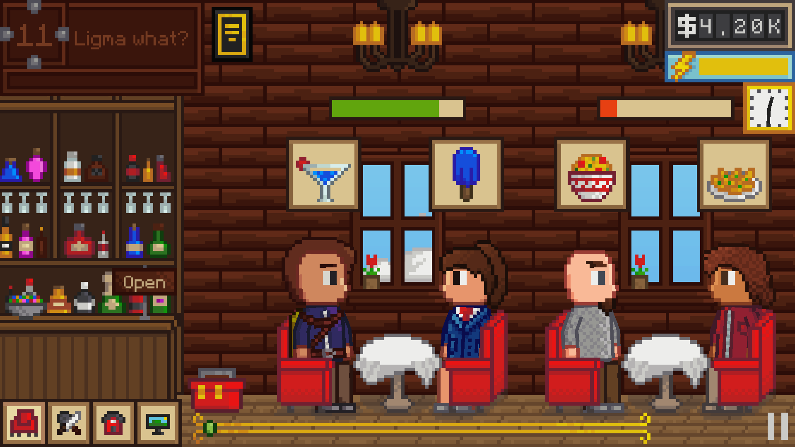
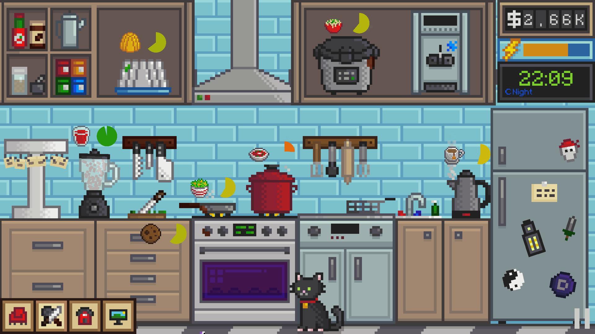
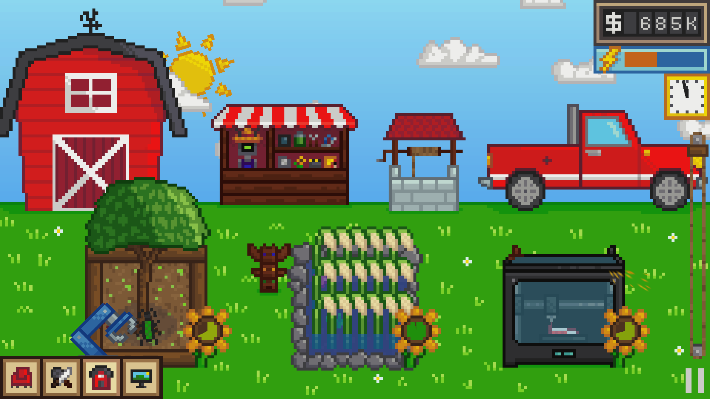
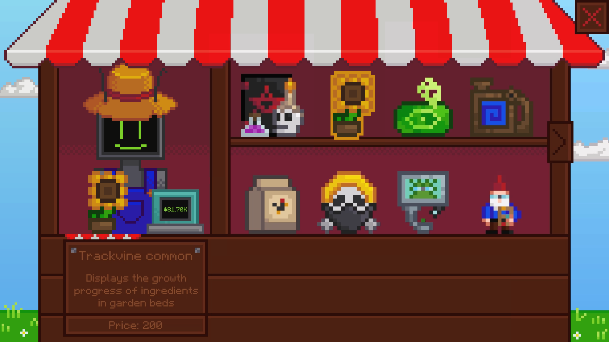
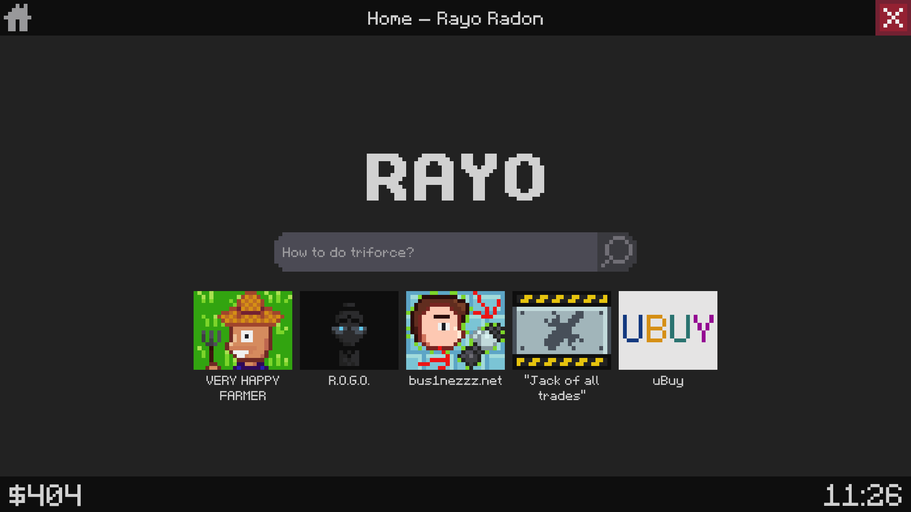

# Description

A mix of café, kitchen, and farming simulators.
- Developed throughout 2024 in my spare time
- Created entirely solo, including game balancing and art
- Conceived as a project to practice and refine my development skills
- The game is available [here](https://nytrock.itch.io/madness-cooking) for download on all major platforms

# Key responsibilities
- Developed flexible save and tutorial systems that can be easily integrated into other systems throughout the project
- Created a universal settings system that can be reused in other projects
- Developed a shop system that allows game designers to modify item purchase conditions without touching the code
- Applied a data-driven approach using ScriptableObjects
- Implemented an event-driven UI and a modular game architecture

# What I would change

- Add a DI framework to replace the current use of multiple dependency injection methods, which complicates development.
- Expand the use of Addressables beyond localization to other game assets to simplify game balancing.
- Add automated tests and Assembly Definitions.

# Screenshots

